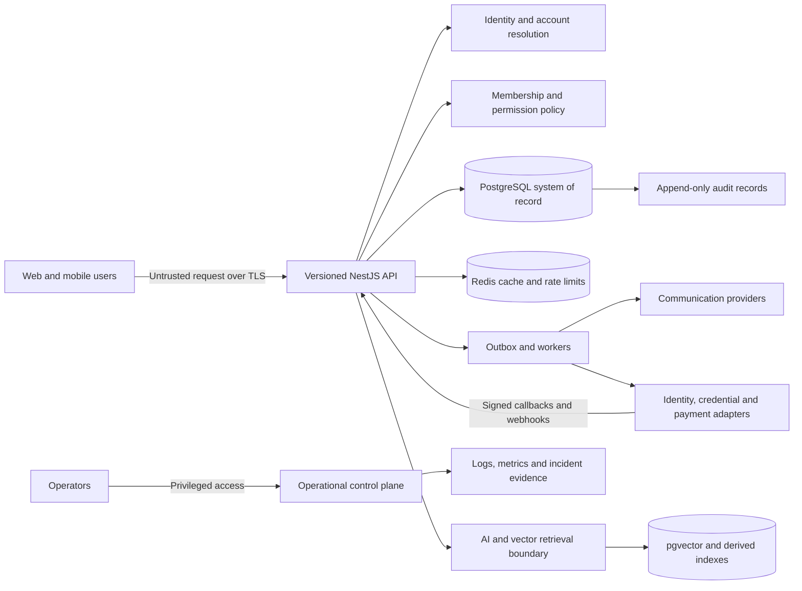

# Domain data-flow and STRIDE baseline

- Status: Engineering draft; review required
- Date: 2026-11-07
- Scope: Identity, marketplace, communication, projects, trust, financial ledger, AI/matching and integrations
- Related: `docs/architecture/overview.md`, `docs/architecture/identity-and-tenancy.md`, `docs/security/threat-model.md`, `docs/security/data-classification.md`

> This is a structured threat-assessment starting point, not a completed independent security review. Flows are logical descriptions derived from repository architecture documents; they do not prove that every component, provider, control or deployment exists. Domain owners must validate each flow, classification, threat, mitigation and residual risk before pilot or production use.

## 1. System context and trust boundaries

### Logical data-flow map

The diagram describes intended logical boundaries only. It does not assert that an identity, payment, credential, messaging or AI provider, production queue, Redis deployment or operational control plane is selected or configured.

### Trust boundaries

| ID | Boundary | Principal risk | Required enforcement |
| --- | --- | --- | --- |
| TB-01 | Browser/mobile to API | Forged credentials, hostile fields, replay and automation | TLS, schema validation, authentication, rate limits and applicable CSRF protections |
| TB-02 | Account/tenant to another account/tenant | Guessed IDs, stale membership and confused-deputy access | Trusted principal, active membership, action permission and tenant-scoped SQL/RLS |
| TB-03 | Public projection to private records | Over-fetching, serialization and index leakage | Allowlisted projections, field classification and access tests |
| TB-04 | API to data stores and workers | Privileged credentials, tenant context leakage and stale messages | Least-privilege roles, transaction-local tenant context, scoped cache keys and authenticated workers |
| TB-05 | Platform to external providers | Provider compromise, forged callbacks and data over-sharing | Provider adapters, isolated secrets, signed callbacks, idempotency and minimal payloads |
| TB-06 | Platform to AI/model services | Prompt injection, retention uncertainty and data disclosure | Data minimization, approved processor terms, retrieval isolation, output validation and human review |
| TB-07 | Operator to production | Excess privilege and untracked access | MFA, just-in-time access, separation of duties and audit |
| TB-08 | Build/release pipeline to runtime | Dependency/workflow compromise and artifact substitution | Pinned actions, lockfile, least-privilege CI, SCA/SAST/secret scanning and provenance |

## 2. Domain flows and STRIDE assessment

Threat priorities below are qualitative planning judgments, not measured likelihoods. Required controls are acceptance criteria unless explicitly identified as an existing repository baseline. Residual risk remains open until mitigations are implemented and tested.

### 2.1 Identity and organization tenancy

**Flow:** Browser/mobile credential and requested organization context → identity adapter validates issuer, subject, signature, audience, expiry and session/revocation state → external identity resolves to one active account → active membership and permission are checked → transaction sets tenant context → PostgreSQL RLS constrains records → material action is audited.

**Data:** Credentials/session metadata (Restricted); external identity mapping and account state (Confidential/Restricted); membership (Confidential); audit metadata (Confidential).

| STRIDE | Scenario | Required controls and evidence |
| --- | --- | --- |
| Spoofing | Stolen, forged, expired or replayed credential impersonates an account | Selected provider; signature/issuer/audience/expiry/revocation validation; session rotation; MFA/recovery safeguards; negative tests |
| Tampering | Client changes account, organization or role identifiers | Derive account from trusted subject; never trust client tenant/role; server-side permission policy; parameterized SQL |
| Repudiation | Sensitive membership/account change cannot be attributed | Minimal append-only audit event in the same transaction; reliable actor and correlation context |
| Information disclosure | Identity evidence, session material or another tenant's membership is exposed | Restricted storage; no public token/hash exposure; object checks; tenant RLS; field allowlists |
| Denial of service | Login, recovery or invitation endpoints are flooded | Per-account/IP/device limits, abuse detection and bounded work |
| Elevation of privilege | Suspended account, stale membership or forged role reaches protected action | Resolve active account/membership per request; action-specific deny-by-default policy; revocation tests |

**Verified gap:** The identity-and-tenancy architecture describes the authorization sequence and transaction-scoped tenant helper. It also states that the membership API is not authenticated: the current guard validates upstream request shape but does not validate credentials or establish a trusted principal. A production identity provider and middleware remain unselected/unconfigured. This blocks authenticated workflows.

### 2.2 Marketplace: opportunities, applications and service listings

**Flow:** User submits listing/application → API validates contract and resolves trusted actor/tenant → domain policy authorizes publication or state change → PostgreSQL persists tenant data → allowlisted public projection/search exposes published fields → notification intent is emitted when an outbox exists.

**Data:** Published listing fields (Public); drafts, applications, commercial terms and private profiles (Confidential); identity/verification evidence (Restricted).

| STRIDE | Scenario | Required controls and evidence |
| --- | --- | --- |
| Spoofing | Attacker applies or edits as another account | Trusted identity, active membership and ownership/participant checks |
| Tampering | Client alters listing owner, status, price or application state | Server-owned fields, validated state transitions and idempotency/concurrency controls |
| Repudiation | Publisher/reviewer disputes a material action | Actor-attributed audit event coupled to state change |
| Information disclosure | Draft applications/private contacts appear in public search | Explicit public DTOs, index allowlists and cross-tenant/object tests |
| Denial of service | Listing/application spam exhausts API or moderation capacity | Quotas, rate limits, abuse reporting and bounded pagination |
| Elevation of privilege | Ordinary member edits another organization's listing | Typed action permissions and resource ownership checks |

**Open validation:** Public discovery and persistence foundations exist; full account lifecycle and marketplace workflows are not verified end to end. Moderation, abuse, retention and public projection behavior require review.

### 2.3 Communication and notifications

**Flow:** Participant initiates/reads conversation → API authenticates actor and checks participation → message is validated/persisted → notification intent is recorded transactionally → worker sends minimal provider payload → callback is authenticated and deduplicated.

**Data:** Message content, attachments and participants (Confidential); destinations/delivery metadata (Confidential); sensitive attachments may be Restricted.

| STRIDE | Scenario | Required controls and evidence |
| --- | --- | --- |
| Spoofing | Sender or provider callback is forged | Trusted actor; provider signature verification and secret rotation |
| Tampering | Message, recipient or delivery state is altered | Immutable authorship; controlled transitions; validated callbacks |
| Repudiation | Sender disputes delivery or moderation action | Minimal append-only history, timestamps and correlation IDs |
| Information disclosure | Non-participant reads conversation or notification reveals content | Participant-scoped reads, minimal notification text and private attachment authorization |
| Denial of service | Message flood, large uploads or notification loops | Rate/size limits, malware scanning, quotas and retry ceilings |
| Elevation of privilege | Support actor reads private messages without purpose | Explicit support permission, just-in-time elevation, reason capture and audit |

**Verified gap:** Conversation persistence and a communication repository/module exist. Complete authenticated participant resolution, notification/consent hooks and abuse/safety controls are not verified.

### 2.4 Project workspaces, milestones and deliverables

**Flow:** Client/provider requests workspace or milestone → trusted actor and active membership are resolved → participant/action predicates are checked → tenant transaction reads or changes state → audit event is committed with material transition → notification intent is queued.

**Data:** Contract scope, project/milestone status, deliverables and acceptance (Confidential); attachments/dispute evidence may be Restricted.

| STRIDE | Scenario | Required controls and evidence |
| --- | --- | --- |
| Spoofing | Non-participant claims to be client/provider | Trusted principal and participant relation from persisted project |
| Tampering | Party changes another party's deliverable or acceptance | Explicit state machine, actor-specific transition policy, concurrency/idempotency |
| Repudiation | Party denies acceptance, revision or cancellation | Same-transaction audit event with actor/action/target/time |
| Information disclosure | Non-participant tenant member reads project data | Participant predicate in addition to tenant RLS; private attachment authorization |
| Denial of service | Unbounded reads or repeated transition requests | Bounded pagination, quotas and idempotency |
| Elevation of privilege | Client-supplied account ID impersonates another participant | Account ID only from trusted principal; membership/object authorization before transaction |

**Verified gap:** PR #41 proposes a typed, read-only participant-scoped repository and tests. It does not authenticate the supplied account ID and adds no API routes or writes. Project creation, milestone transitions, audit semantics and trusted identity remain deferred. Revalidate after merge.

### 2.5 Trust evidence, verification and moderation

**Flow:** User submits evidence → API checks purpose, legal basis/consent and upload constraints → evidence enters private segregated storage → authorized reviewer receives restricted work item → decision/rationale is persisted → public projection exposes only approved status → expiry/revocation and retention processes update access.

**Data:** Identity documents, credentials and verification artifacts (Restricted); reviewer decisions/risk signals (Confidential/Restricted); approved public status (Public).

| STRIDE | Scenario | Required controls and evidence |
| --- | --- | --- |
| Spoofing | Fraudulent issuer, reviewer or submitter | Issuer/proof verification and reviewer identity/role checks |
| Tampering | Evidence or reviewer decision is altered | Integrity metadata, immutable decision history and controlled correction/revocation |
| Repudiation | Reviewer disputes a decision or evidence provenance | Attributed append-only decision events and provenance |
| Information disclosure | Evidence/reviewer identity leaks through API, search or logs | Private storage, narrow reviewer authorization, public projection allowlist and log redaction |
| Denial of service | Malicious uploads exhaust storage/scanning | File allowlists, size limits, malware scanning, quotas and quarantine |
| Elevation of privilege | Submitter self-approves or accesses another review | Separation of submitter/reviewer authority, explicit reviewer permission and audited break-glass |

**Verified gap:** Trust evidence-intake and decision migrations exist. Complete authenticated submission, reviewer authorization, decision/revocation APIs, retention and private storage controls are not verified end to end.

### 2.6 Financial ledger and payment boundary

**Flow:** Business action requests journal operation → trusted actor and active membership resolve → explicit journal-action policy allows/denies → balanced journal header/lines, audit event and minimal outbox event commit atomically → worker handles idempotent event → reconciliation monitors outcomes. External payment providers and funds movement are outside this baseline.

**Data:** Journal entries, payment references and reconciliation/refund metadata (Confidential/Restricted); provider secrets (Restricted).

| STRIDE | Scenario | Required controls and evidence |
| --- | --- | --- |
| Spoofing | Forged actor/provider event initiates journal operation | Trusted actor; signed provider webhook only after separate provider approval |
| Tampering | Journal line or posted amount is altered | Balanced double-entry invariants, immutable journal and separately authorized reversal |
| Repudiation | Posting/reversal cannot be attributed | Same-transaction append-only audit event with actor, policy decision and correlation ID |
| Information disclosure | Cross-tenant balances/payment references are exposed | Tenant RLS, explicit tenant predicates and non-enumerating errors |
| Denial of service | Duplicate/replayed commands or event storms cause unbounded work | Idempotency, bounded retries, rate limits and reconciliation |
| Elevation of privilege | Membership role is assumed to grant posting/refund authority | Explicit action-specific deny-by-default policy; no inferred role grants; separate threshold if decided |

**Blocking human decision:** Issue #39 must define who may post, reverse or refund journals and whether a separate finance permission/approval threshold is required. No membership role is presumed to carry financial authority.

**Hard boundary:** This document authorizes no live funds movement, custody, provider integration or authenticated payment route. Do not expose posting until trusted identity, explicit policy, atomic audit/outbox and PostgreSQL integration evidence are reviewed.

### 2.7 AI, vector retrieval and recommendations

**Flow:** Profile/listing data is minimized/classified → approved pipeline creates embeddings/features → PostgreSQL/pgvector or approved processor receives permitted inputs → tenant/visibility-scoped retrieval → validated model output is presented as decision support → user can correct, opt out where appropriate or appeal consequential outcomes.

**Data:** Profile/capability/behavior signals (Confidential); sensitive evidence/protected attributes (Restricted and excluded unless specifically approved); embeddings inherit source classification.

| STRIDE | Scenario | Required controls and evidence |
| --- | --- | --- |
| Spoofing | Poisoned profile/corpus impersonates qualified person | Provenance, verification signals and abuse monitoring |
| Tampering | Prompt injection or poisoned content alters model behavior | Treat retrieved content as untrusted; isolate instructions; validate outputs/tool permissions |
| Repudiation | Consequential score cannot be explained | Record model/version, input provenance, explanation, confidence and user-visible effect |
| Information disclosure | Embedding/prompt leaks private profile, messages or evidence | Minimize/redact inputs; tenant/visibility filters before retrieval; processor retention review |
| Denial of service | Expensive prompts/embedding floods exhaust budget | Quotas, timeouts, token limits, caching and circuit breakers |
| Elevation of privilege | Model output triggers unauthorized action/tool | Decision support initially; no authority-bearing tools without server policy and human review |

**Open validation:** Architecture calls for explainability, correction, opt-out where appropriate, appeal and human review for consequential decisions. Model provider, retention terms, evaluation and production data flows are not established.

### 2.8 External integrations and asynchronous events

**Flow:** Domain service writes state and outbox record atomically → worker claims event → adapter sends minimum payload with scoped secret → provider responds or sends signed callback → callback is verified/deduplicated → outcome is recorded and retried/dead-lettered under policy.

**Data:** Provider credentials/configuration (Restricted); event payloads/delivery metadata (Confidential); payload classification cannot exceed the provider's approved purpose.

| STRIDE | Scenario | Required controls and evidence |
| --- | --- | --- |
| Spoofing | Forged webhook or worker identity | Signature verification, timestamp/replay window, secret rotation and workload identity |
| Tampering | Queue payload or provider response is modified | Authenticated transport, versioned schema, integrity validation and transition checks |
| Repudiation | Delivery/processing cannot be reconstructed | Correlation/event IDs, minimal immutable event history and provider response references |
| Information disclosure | Secrets or excess tenant data leak to provider/logs | Secret manager, payload minimization, redaction and processor review |
| Denial of service | Provider outage/poison event creates retry storm | Exponential backoff with jitter, bounded retries, circuit breaker and dead-letter operations |
| Elevation of privilege | Compromised integration secret accesses unrelated resources | Per-provider/environment credentials, least privilege, scoped rotation and access review |

**Verified gap:** Provider adapters and a complete transactional outbox are not verified as implemented. Do not call an integration operational until secret boundaries, signature verification, idempotency, retries, dead-letter handling and ownership are tested.

## 3. Cross-cutting controls and evidence

| Control | Minimum evidence before pilot | Current evidence boundary |
| --- | --- | --- |
| Authentication | Selected provider, validated middleware, account resolution and invalid/revoked credential tests | Production identity integration not implemented/verified |
| Authorization | Typed action permissions, active membership and object/cross-tenant negative tests | Shared permission policy exists; per-domain enforcement remains open |
| Tenant isolation | RLS tests under actual non-owner runtime role; absent/malicious context tests | PostgreSQL RLS workflow exists; confirm coverage per domain |
| Audit | Atomic coupling, immutability and restricted-reader tests | Append-only persistence exists; domain coupling incomplete |
| Outbox | Atomic write, idempotent delivery, retry/dead-letter tests and runbook | Complete transactional outbox not verified |
| Secrets | Managed store, rotation and no-secret-in-logs evidence | Repository secret scanning exists; runtime secret operations need separate evidence |
| Dependencies/build | Frozen lockfile, dependency review/audit, CodeQL and secret scanning | CI workflows exist; repo alert settings and SBOM/provenance require separate verification |
| Privacy | Purpose/lawful basis, processor inventory, retention/deletion and DPIA decision | Privacy principles documented; jurisdiction-specific review open |
| Operations | Incident, revocation, key rotation, backup/restore runbooks and RPO/RTO proof | Not established by CI success |
| Independent assurance | Penetration, accessibility and load/reliability findings with remediation | Not established |

## 4. Required review workflow

For each domain, the accountable owner and security/privacy reviewer must:

1. Validate the flow against deployed components, real stores, processors, queues and operational access.
2. Inventory each field/event, classification, purpose, lawful basis, retention and deletion behavior.
3. Record threat actor, preconditions, impact, likelihood rationale, existing control, mitigation, owner and due date.
4. Verify mitigations with negative tests and operational evidence; link exact CI runs, artifacts and runbooks.
5. Record residual risk and obtain attributable risk acceptance from the authorized decision owner.
6. Reassess after material architecture, provider, purpose or jurisdiction changes.

### Exit criteria

Mark this draft reviewed only when all eight flows are validated, threats are individually owned/prioritized, controls are evidenced, privacy/legal decisions are recorded and residual risks are accepted by authorized owners. Independent penetration testing, DPIA where required, restore proof and production launch approval remain separate gates.

## 5. Explicit non-claims

This document does not certify security, privacy, compliance or production readiness. It does not select an identity, payment, credential, messaging or AI provider; prove any external integration is configured; grant financial permissions; or authorize live funds movement. Green CI is necessary but insufficient evidence for release.
